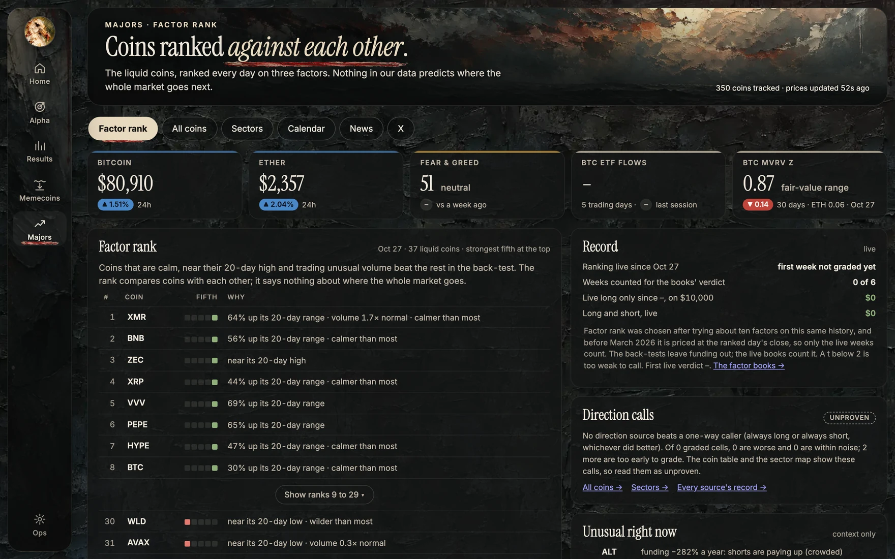
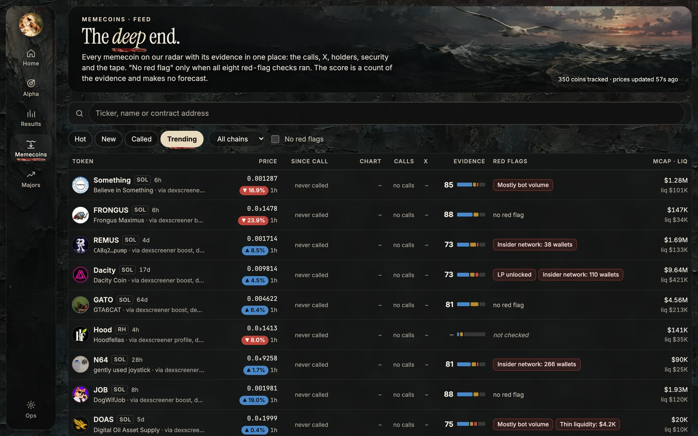
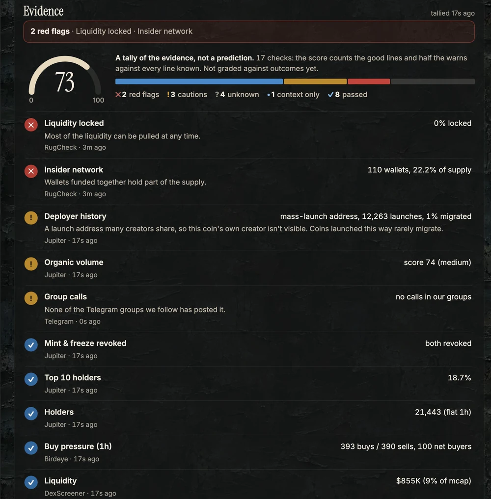
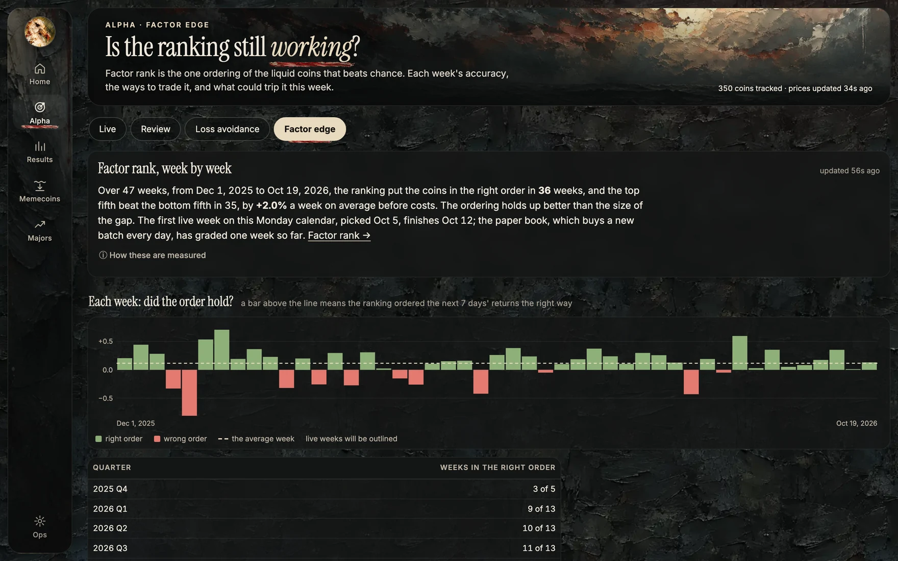
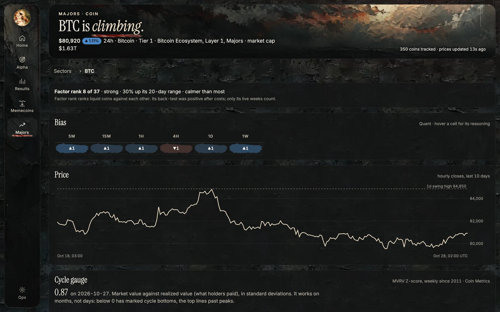
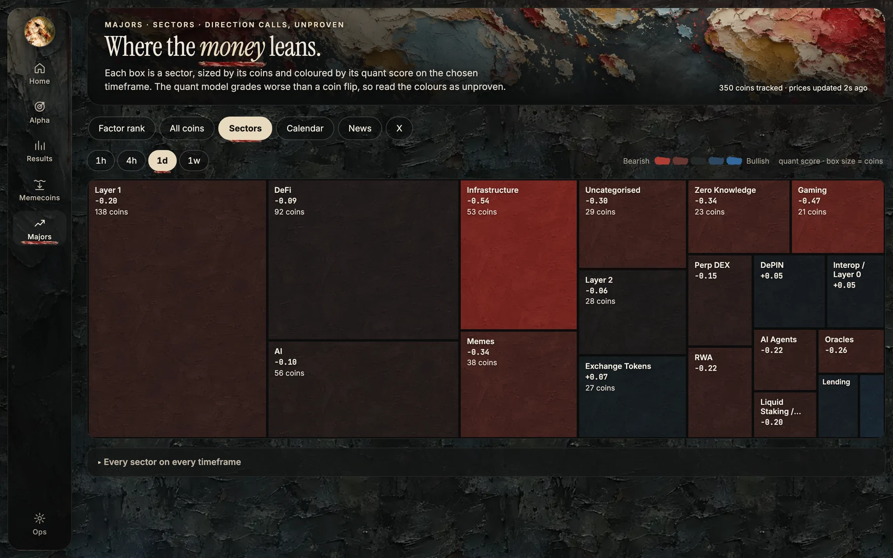
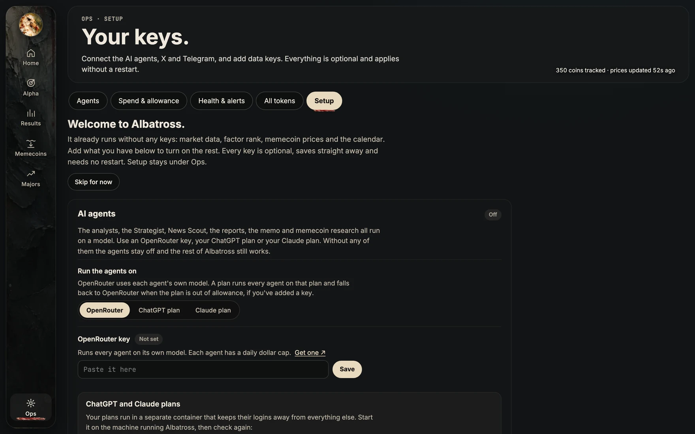

# Albatross

**Self-hosted crypto research that keeps score.** Albatross collects market, derivatives, on-chain, news and social
data around the clock, runs deterministic models and AI analyst agents on it, logs every call any source makes, and
grades each call against what the price did next. It is paper only: it never places a trade.

Most crypto tools show you signals. Albatross keeps score of them, including its own, and tells you which ones have
held up.

<p align="center">
  
</p>

## What it does

- **Bias matrix.** A long or short lean for every coin and sector on six timeframes (5m, 15m, 1h, 4h, 1d, 1w), from
  a quant model, three analyst agents, a macro analyst and an accuracy-weighted ensemble.
- **Factor rank.** A daily ranking of the liquid Hyperliquid perps (30-day median volume over $5M) by low volatility,
  nearness to the 20-day high and volume shock, with the top and bottom fifths tracked as weekly paper books.
- **Memecoins.** Dossiers on a few hundred Solana memecoins with red-flag checks (dev wallet, liquidity, mint
  authority, tax, top-10 holders, coin age), wallet clusters, and X, Reddit and GitHub reads. Every Telegram group
  call or bot buy you feed in gets a SKIP or PASS verdict at the moment it lands, and its 24-hour result.
- **Call ledger and paper books.** Every call goes into an append-only, hash-chained ledger at a price we trust. Paper
  books turn each kind of call into dollars after fees, slippage and funding, with rules fixed before the results.
- **Strategy lab.** Generates and tests about 270 strategies a day. The bar rises with the number tried, so the
  survivors aren't luck from testing many.
- **Agent review.** Agents that don't beat a fair random baseline lose budget and weight each week, and earn them back
  with evidence.
- **Intel.** Events calendar (unlocks, listings, macro dates, Polymarket odds), news triage, X sentiment with cited
  posts, ETF flows, stablecoin supply, MVRV.
- **Ops.** Job health, per-agent spend and budgets, and Telegram alerts.

### In action

These are from a fresh install a few hours after its first start, with no keys: real market data, and no AI agents
yet.

<table>
<tr>
<td width="50%" valign="top"><br>
<b>Memecoins.</b> Every token on the radar with its evidence score and red flags, found and checked within minutes of
the first start.</td>
<td width="50%" valign="top"><br>
<b>A dossier.</b> Seventeen checks from RugCheck, Jupiter, Birdeye and DexScreener, each with where it came from and
how old it is. A tally of the evidence, not a prediction.</td>
</tr>
<tr>
<td width="50%" valign="top"><br>
<b>Is the ranking still working?</b> Each week, whether the factor rank put the next 7 days' returns in the right
order. Live weeks are graded as they close.</td>
<td width="50%" valign="top"><br>
<b>Every coin.</b> Its factor rank, the quant model's lean on six timeframes, its price and the MVRV cycle gauge.</td>
</tr>
<tr>
<td width="50%" valign="top"><br>
<b>Sectors.</b> Each box sized by its coins and coloured by the quant score, labelled unproven because the quant
model hasn't beaten a coin flip.</td>
<td width="50%" valign="top"><br>
<b>Setup.</b> Opens on the first visit. Add keys, connect your ChatGPT or Claude plan, X and Telegram; nothing needs
a restart.</td>
</tr>
</table>

## What to expect

**The first hour.** Open http://localhost:8787 and Setup greets you. Nothing needs a key to start:

- The coin list builds first: about 15 minutes on CoinGecko's free tier, or 2 with a free Demo key.
- Then a year of hourly candles, five years of daily ones and 30 days of 5-minute ones download from Hyperliquid, OKX
  and Coinbase. Funding and open interest update every minute, headlines every 3.
- Memecoins start arriving within minutes. Discovery reads DexScreener and GeckoTerminal, and each token gets a dossier
  with its safety checks (RugCheck, honeypot.is), pools and price.

**The first day.**

- The factor rank runs at 00:30 UTC. To see it sooner, run
  `docker compose exec ingest python -m albatross job factor_rank` once the daily candles are in.
- Every coin gets the quant model's lean on each timeframe, and the sector map fills in.
- The strategy lab starts testing on the history it just downloaded.
- The calendar collects listings, Polymarket odds and FOMC dates; CPI, jobs and GDP release dates need a free FRED key.

**With an AI lane** (an OpenRouter key, or your ChatGPT or Claude plan):

- The analysts post calls every 30 minutes to 4 hours, News Scout scores headlines, and a brief lands every 4 hours.
- The CEO memo reviews the whole desk twice a day.
- Memecoins get a written take and, with an xAI key, an X read.
- On OpenRouter the full set came to about $50 a day in October 2026; every agent has a daily cap, and you can switch
  agents off or to cheaper models.

**The first weeks.** Calls are graded as their windows close: hours for an hourly call, a day for a memecoin call.

- A source needs 20 to 30 graded calls before the scorecards give it a verdict.
- The agent review runs every Thursday and cuts the budget of agents that haven't beaten a fair random baseline.
- The paper books read after a few weeks. A strategy's live record needs months before it means much.

**What it won't do.** It won't trade, and it won't tell you what to buy. So far no direction call, from a model or an
agent, has beaten a naive caller; the evidence below says what has held up.

**A machine to run it on.** Docker with 4 CPUs and 6 GB of memory runs it comfortably; the three containers used
about 1.3 GB of memory a few hours in. The database was about 600 MB after the first download and grows from there,
so keep a few GB of disk free.

## What the evidence says so far

From its own grading, up to October 2026. Details in [docs/RESEARCH-EDGE.md](docs/RESEARCH-EDGE.md).

- **Direction calls don't beat a naive caller.** No source, model or agent called market direction better than
  always-long or always-short on the same windows.
- **Factor rank orders coins.** The weekly rank correlation with the next week's returns averaged 0.11 (t 3.1) and was
  positive in every quarter for a year. After costs the edge is thin: long-short made +0.58% a week (t 1.3), and
  long-only beat the market by +1.14% a week (t 2.4).
- **Memecoin age matters more than anything else in the checklist.** Held 24 hours after a Telegram call:

  | Coin age at the call | Calls | Median | Lost 90%+ |
  |---|---|---|---|
  | Under 1 hour | 706 | −83% | 37% |
  | 1 to 24 hours | 554 | −66% | 20% |
  | 24 hours or more | 599 | −22% | 4% |

  Buying every call still lost money. The checklist cuts the wipeouts; it doesn't make the calls profitable.

## Quick start

You need Docker and, for development, [uv](https://docs.astral.sh/uv/).

```bash
git clone https://github.com/Shoestring-dev/albatross-oss.git albatross && cd albatross
docker compose up -d --build
```

Open http://localhost:8787. The first visit opens **Setup** (also under Ops), where you add keys and connect your
accounts. Every key is optional, saves straight away and needs no restart. Migrations run when the `ingest` container
starts. Candles, funding and the universe build up over the first hour; daily features and the factor rank appear
after the next 00:30 UTC run.

With no keys at all you get market data, derivatives, factor rank, memecoin prices and the events calendar.

If you'd rather keep keys in a file, `cp env.template .env` and fill it in before `docker compose up`.
[env.template](env.template) lists every key and what it turns on. A key in `.env` wins over one saved in Setup.

```bash
uv sync
uv run pytest -q                           # tests, no database needed
uv run python -m albatross status          # job health and row counts
uv run python -m albatross job <name>      # run one job now (names in albatross/__main__.py)
```

## Connecting accounts

All of this is on the Setup page.

- **AI agents.** Add an OpenRouter key, or run the agents on your own ChatGPT or Claude plan. The plans run in a
  separate container that keeps their logins away from everything else; start it with
  `docker compose --profile subscriptions up -d`. Then sign in to ChatGPT from Setup, or paste a token from
  `claude setup-token`. With an OpenRouter key as well, an agent falls back to it when the plan is out of allowance.
  Your plan's own terms and limits apply.
- **X.** Add an xAI API key for X search, capped at a daily dollar amount. If you have SuperGrok, the Grok CLI on the
  host worker can do the same (`uv run python -m albatross host`).
- **Telegram.** Your own bot sends the alerts. To log calls from the groups and channels you're in, sign in with your
  own Telegram account (an API id and hash from my.telegram.org) and pick the chats. Every token address posted there
  becomes a call with a SKIP or PASS verdict. Your own program can also push calls to the call feed
  ([deploy/call-feed/README.md](deploy/call-feed/README.md)).
- **Data keys.** CoinGecko, Coinalyze, FRED, Birdeye, Jupiter, a Solana RPC and the rest, each with a Test button.

Setup answers only at `localhost` unless you set a site password or list a host name in `ALLOWED_HOSTS`, so another
website can't reach it through your browser. Saved keys live in the database (`app_settings`): treat database
backups like the keys themselves.

## Running costs

Data costs are small: most sources are free, and the memecoin lane is best with a paid Birdeye plan. The AI agents are
the main cost. Running the full agent set on API pricing came to roughly $50 a day in October 2026; each agent has a
daily cap, and the weekly review cuts the ones that don't earn their keep. On a ChatGPT or Claude plan the agents use
your plan's allowance instead, and fall back to OpenRouter only if you've added a key. Turn agents off or switch them to cheaper
models in [docs/MODELS.md](docs/MODELS.md).

## Docs

- [docs/ARCHITECTURE.md](docs/ARCHITECTURE.md): how the pieces fit, the database, deployment, known gotchas
- [docs/MODELS.md](docs/MODELS.md): which model each agent uses and how to change it
- [docs/RESEARCH-EDGE.md](docs/RESEARCH-EDGE.md): what works and what doesn't, with numbers
- [docs/PLAN-LEARNING-LOOP.md](docs/PLAN-LEARNING-LOOP.md): how agents are graded, promoted and cut
- [docs/SPEC-LEDGER.md](docs/SPEC-LEDGER.md), [docs/SPEC-MICROCAPS.md](docs/SPEC-MICROCAPS.md),
  [docs/SPEC-DEEP-END.md](docs/SPEC-DEEP-END.md), [docs/SPEC-EVENTS.md](docs/SPEC-EVENTS.md): design specs

## Data sources

Albatross calls third-party APIs with your keys, under your accounts. You are responsible for following each
provider's terms, especially if you show their data to anyone else. [NOTICE.md](NOTICE.md) lists the sources and what
to check for each.

## Not financial advice

Albatross is research software. Its output is not investment advice or a recommendation to buy or sell anything.
Past results, paper or backtested, don't predict future ones. Crypto, and memecoins especially, can go to zero.

## License

[GNU Affero General Public License v3.0](LICENSE). If you run a modified version as a service for others, you must
offer them its source.
